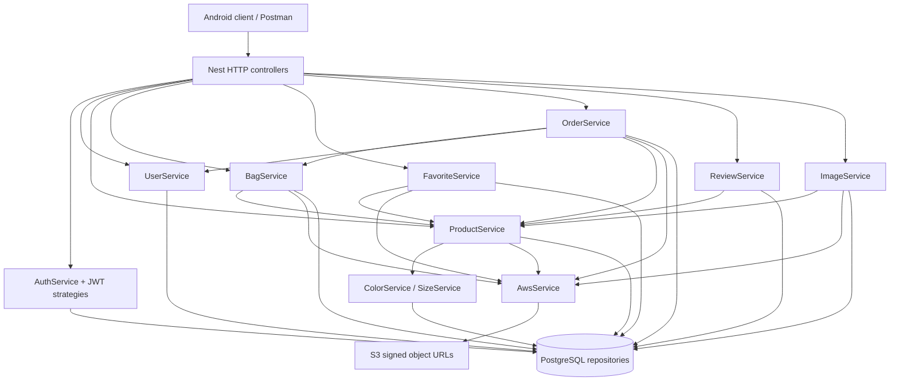
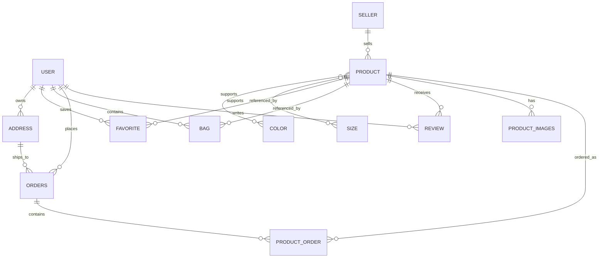
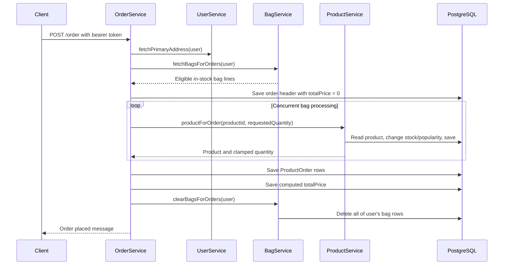

# FStore Backend: Complete Code Study and Git Timeline

**Analysis date:** October 12, 2026, Asia/Calcutta.  
**Repository snapshot:** `137652d6deab28ea4f1b1b5a534fd2b95795ddf1` on local `main`.  
**Backend directory:** `fstore-backend/`.  
**Recorded Git range:** July 28, 2024, **10:41:16–11:02:35 IST**, a span of **21 minutes 19 seconds**.  
**Backend addition:** July 28, 2024, **10:46:41 IST**, commit `fda1bbe5`.

This document explains the backend as implemented in the uploaded repository. It covers every first-party backend source file, application configuration, tests, API contracts, database entities, business workflows, Android integration points, and the locally available Git history. Observed code behavior and suggested improvements are distinguished throughout.

Git timestamps show when commits were recorded. They do **not** prove when coding began, how many hours the backend took to build, or when commits were pushed to GitHub. No remote push events or server deployment history were supplied. The analysis uses the local checkout; no remote fetch was performed.

## Contents

1. [Executive assessment](#1-executive-assessment)
2. [Git timeline and time interpretation](#2-git-timeline-and-time-interpretation)
3. [Scope, evidence, and verification limits](#3-scope-evidence-and-verification-limits)
4. [Technology stack and repository layout](#4-technology-stack-and-repository-layout)
5. [Application startup and module architecture](#5-application-startup-and-module-architecture)
6. [Database model](#6-database-model)
7. [Authentication and identity](#7-authentication-and-identity)
8. [Complete API catalog](#8-complete-api-catalog)
9. [Product catalog and filtering](#9-product-catalog-and-filtering)
10. [Addresses and profile](#10-addresses-and-profile)
11. [Favorites](#11-favorites)
12. [Shopping bag](#12-shopping-bag)
13. [Checkout and orders](#13-checkout-and-orders)
14. [Reviews and ratings](#14-reviews-and-ratings)
15. [Images and AWS S3](#15-images-and-aws-s3)
16. [DTOs, validation, and serialization](#16-dtos-validation-and-serialization)
17. [Android and Postman integration](#17-android-and-postman-integration)
18. [Configuration, scripts, and operation](#18-configuration-scripts-and-operation)
19. [Detailed findings and priorities](#19-detailed-findings-and-priorities)
20. [Testing and verification plan](#20-testing-and-verification-plan)
21. [Learning path and implementation roadmap](#21-learning-path-and-implementation-roadmap)
22. [Complete source-file inventory](#22-complete-source-file-inventory)

## 1. Executive assessment

FStore is a NestJS REST backend for an Android commerce application. Its primary domains are customer and seller authentication, products, customer addresses, favorites, shopping bags, orders, reviews, and product media. PostgreSQL stores relational data. AWS S3 stores image objects; the backend generates temporary upload and download URLs.

The application is a **modular monolith**: all feature modules run inside one Nest application, share one database connection, and call injected services directly. There is no message broker, separate worker, payment gateway, shipping service, or independent microservice in the first-party backend.

The code demonstrates substantial end-to-end feature coverage: buyers can register, browse and filter products, select variants, manage a bag, choose an address, place an order, and create reviews. Sellers can register, create products, update their own products, and request product-image upload URLs.

Important implementation gaps affect correctness and security:

- Customer and seller JWTs share the same secret, lack an explicit role claim, and are resolved by numeric ID alone. A valid token can be interpreted as the other account type when IDs overlap.
- Several address, bag, and image mutations authenticate the caller but do not verify ownership of the target object.
- Checkout changes inventory, writes orders, and clears the bag without a transaction or stock locking.
- Bag prices can be supplied by clients, while checkout independently uses undiscounted product prices.
- Repeated review submissions change aggregate ratings before duplicate reviews are rejected.
- The repository tracks `.env`, dependencies, and compiled artifacts. Secret values are not reproduced in this report.
- The sole first-party test is a generated root-route test that does not match the current application.

These findings are based on source inspection. They are not claims that a deployed service was attacked or that runtime tests passed.

## 2. Git timeline and time interpretation

### 2.1 All locally available commits

All author and committer timestamps agree for these four commits. Original timestamps already use the user's timezone offset, `+05:30`.

| Commit | Author | Author/committer timestamp, IST | Subject | Observed scope |
| --- | --- | --- | --- | --- |
| `89e44e26` | `kishore-bot` | 2024-07-28 10:41:16 | Initial commit | Initial application repository snapshot; backend source is introduced by the next commit |
| `fda1bbe5` | `kishore-bot` | 2024-07-28 10:46:41 | Adding backend | Backend source, configuration, dependencies, compiled artifacts, and tracked environment file |
| `7dfc9400` | `kishore-bot` | 2024-07-28 10:58:06 | Adding Readme | Root README, Postman collection, UI documentation and images |
| `137652d6` | `KishoreK` | 2024-07-28 11:02:35 | Update README.md | Root README edits |

### 2.2 Recorded intervals

| Interval | Elapsed time | What it establishes |
| --- | --- | --- |
| Initial commit → backend addition | 5 minutes 25 seconds | Gap between two commit timestamps |
| Backend addition → documentation addition | 11 minutes 25 seconds | Gap between code upload snapshot and documentation snapshot |
| Documentation addition → final README edit | 4 minutes 29 seconds | Gap between documentation commits |
| Initial commit → latest available commit | 21 minutes 19 seconds | Full locally recorded repository history span |
| First → last backend source commit | 0 seconds | Backend source appears in one commit; no later source evolution is recorded |

**Safe description:** “The available repository history records the project and backend additions on July 28, 2024, over a 21-minute-19-second commit window. The backend was added at 10:46:41 IST.”

**Unsupported description:** “The complete backend was developed in five minutes.” The gap between commits cannot establish development effort.

### 2.3 Backend history and repository size

- `git log --all -- fstore-backend/src` returns only `fda1bbe5`.
- That commit adds **80 files and 3,653 lines** under `fstore-backend/src` and `fstore-backend/test`.
- Current tracked `src` inventory: **78 TypeScript files**, **3,620 physical lines**. Physical lines include comments and blank lines; they are not executable-line counts.
- Current tracked backend inventory: **29,061 files**, of which **28,736** are under `fstore-backend/node_modules`.
- The backend-addition commit's repository-wide summary reports **29,062 files changed**, **3,464,929 insertions**, and **27 deletions**. This includes dependencies and other artifacts and must not be reported as handwritten backend code size.
- Local branch inventory contains `main` and `origin/main`; the checkout is not shallow. This does not establish that every historical remote branch or deleted commit exists locally.
- No per-feature creation timeline can be recovered from a single backend source commit.

### 2.4 Commands to reproduce the timeline

```powershell
git log --all --reverse --format='%h|%aI|%cI|%an|%s'
git log --all --format='%h|%aI|%s' -- fstore-backend/src
git show --format=fuller --no-patch fda1bbe5
git diff --shortstat 89e44e26 fda1bbe5 -- fstore-backend/src fstore-backend/test
git rev-parse --is-shallow-repository
```

Git commit dates are author-supplied metadata. They support a recorded timeline, not an independently verified publication timestamp.

## 3. Scope, evidence, and verification limits

### 3.1 Inspected material

| Material | Purpose |
| --- | --- |
| Every file under `fstore-backend/src` | Runtime implementation, module wiring, entities, DTOs, guards and interceptors |
| `package.json` and `package-lock.json` | Commands, declared dependencies and locked versions |
| `main.ts`, `app.module.ts` | Startup, global validation, configuration and database setup |
| `docker-compose.yml` | Local PostgreSQL infrastructure |
| TypeScript, Nest, ESLint and Prettier configuration | Compilation and code-quality behavior |
| `test/app.e2e-spec.ts`, `test/jest-e2e.json` | Existing test coverage and assumptions |
| Root/backend READMEs and root `.gitignore` | Existing documentation and repository hygiene |
| `documents/FStore.postman_collection.json` | Sample API usage and contract drift |
| Android API interfaces, constants, token interceptor and relevant models | Client/server contract expectations |
| Local Git history and tracked-file lists | Time range, provenance and source/artifact counts |
| Installed Nest `ValidationPipe` implementation | Precise behavior of DTO conversion with the current pipe options |

Generated `dist` files and third-party `node_modules` are not counted as first-party source. The authoritative application study uses `src`, rather than treating compiled copies as separate implementations.

### 3.2 Verification limits

- `node --version` and `npm --version` failed because those commands are unavailable in this environment. The common `C:/Program Files/nodejs` locations were also absent.
- No application build, Jest execution, database connection, API request, AWS request, or migration was performed.
- Environment-file values were not read into this report. Tracked status of `fstore-backend/.env` was verified by filename only.
- Actual PostgreSQL schema, deployed IAM policies, existing database content, and S3 object availability were not inspected.
- Example JSON below illustrates source-defined contracts; it is not captured output from a running backend.
- This task adds documentation. It does not modify or remediate application code.

## 4. Technology stack and repository layout

### 4.1 Dependencies

Versions below come from this repository's lockfile, not a claim about current upstream releases.

| Technology | Declared range | Locked version | Role |
| --- | --- | --- | --- |
| Nest common/core | `^10.0.0` | `10.3.9` | HTTP framework, dependency injection, decorators |
| TypeORM | `^0.3.20` | `0.3.20` | Entities, repositories and query builders |
| PostgreSQL driver `pg` | `^8.12.0` | `8.12.0` | Database transport |
| TypeScript | `^5.5.3` | `5.5.3` | Source language and compilation |
| `class-validator` | `^0.14.1` | `0.14.1` | Request DTO validation |
| `class-transformer` | `^0.5.1` | `0.5.1` | Normalization and response shaping |
| AWS S3 client | `^3.617.0` | `3.617.0` | GET/PUT object command construction |
| AWS S3 presigner | `^3.617.0` | `3.617.0` | Temporary object URLs |
| Jest | `^29.5.0` | `29.7.0` | Testing |

Additional declared runtime packages include `@nestjs/config`, `@nestjs/jwt`, `@nestjs/passport`, `@nestjs/typeorm`, `@nestjs/platform-express`, `passport`, `passport-jwt`, `passport-local`, `reflect-metadata`, `rxjs`, and `uuid`. Password hashing uses Node's built-in `crypto.scrypt`, rather than bcrypt. No active local-auth strategy or UUID-based order generation appears in the source.

**Packaging issue:** `typeorm` is declared under `devDependencies` despite runtime imports throughout the application. A deployment that omits development dependencies can lack a direct runtime dependency. Move it to `dependencies` and verify a production-only install.

### 4.2 Layout

```text
FStore-App/
├── app/                              Android application
├── documents/
│   ├── FStore.postman_collection.json
│   ├── BACKEND_CODE_STUDY.md          This report
│   └── ui/                           Screen references
├── dist/                             Root-level compiled artifacts
└── fstore-backend/
    ├── src/
    │   ├── main.ts                   HTTP bootstrap
    │   ├── app.module.ts             Root composition and database
    │   ├── auth/                     User/seller credentials and JWT
    │   ├── user/                     Profiles and delivery addresses
    │   ├── seller/                   Seller entity and empty admin scaffold
    │   ├── product/                  Catalog, variants, inventory, aggregates
    │   ├── favorite/                 Wishlist
    │   ├── bag/                      Shopping cart
    │   ├── order/                    Checkout and history
    │   ├── review/                   Comments and ratings
    │   ├── image/                    Product media records and upload URLs
    │   ├── aws/                      S3 URL signing
    │   └── interceptor/              Response serializers
    ├── test/                         One generated e2e test and Jest config
    ├── dist/                         Backend compiled artifacts
    ├── node_modules/                 Tracked dependency files
    ├── .env                          Tracked; values omitted
    ├── docker-compose.yml            PostgreSQL only
    ├── package.json
    ├── package-lock.json
    ├── nest-cli.json
    ├── tsconfig.json
    └── tsconfig.build.json
```

File spellings such as `entitty`, `adress`, `qunatity`, `startegies`, and `interceptot` are preserved in this report so links match the repository.

## 5. Application startup and module architecture

### 5.1 Bootstrap

Source: [main.ts](../fstore-backend/src/main.ts).

1. `NestFactory.create(AppModule)` builds the application and initializes injected providers.
2. `ValidationPipe({ whitelist: true })` is attached globally.
3. HTTP listens on hardcoded port **3000**.

There is no global route prefix. Endpoints are `/auth/...`, `/product/...`, etc., rather than `/api/...`. The source does not configure Swagger, CORS, a health route, API versioning, request throttling, explicit shutdown hooks, or a custom exception filter. Those features are therefore not part of the visible application configuration.

### 5.2 Root module and persistence

Source: [app.module.ts](../fstore-backend/src/app.module.ts).

- `ConfigModule.forRoot({ isGlobal: true })` loads configuration for all modules.
- `TypeOrmModule.forRootAsync` creates the PostgreSQL connection.
- Host is hardcoded to `localhost`; port is hardcoded to `5432`.
- Database credentials/name are fetched from `USER_NAME`, `PASSWORD`, and `DB_NAME`.
- Twelve entity classes are explicitly registered.
- `synchronize: true` automatically aligns the schema to entity metadata at application initialization.
- All feature modules are imported into the root.
- `AwsService` is both provided directly by `AppModule` and exported from `AwsModule`, creating redundant provider registration.

Automatic schema synchronization is convenient for a prototype. A production deployment needs reviewed migrations and a controlled schema-change process; the existing migration scripts reference a missing source file.

### 5.3 Service dependency map



### 5.4 Module registrations

| Module | Repositories registered with `forFeature` | Providers / exports | Feature dependencies |
| --- | --- | --- | --- |
| Auth | User, Seller | AuthService and both JWT strategies; no explicit service export | PassportModule, two JwtModule registrations |
| User | User, Address | UserService; exports UserService | None beyond persistence |
| Seller | None | SellerService; empty controller | Scaffold only |
| Product | Product, Color, Size | ProductService, ColorService, SizeService; exports ProductService | AwsModule |
| Favorite | Favorite | FavoriteService; exports FavoriteService | ProductModule via `forwardRef`, AwsModule |
| Bag | Bag | BagService; exports BagService | ProductModule, AwsModule |
| Order | Orders, ProductOrder | OrderService | BagModule, UserModule, ProductModule, AwsModule |
| Review | Review | ReviewService | ProductModule |
| Image | ProductImages | ImageService | ProductModule, AwsModule |
| Aws | None | AwsService; exports AwsService | Global ConfigService |

`FavoriteModule` uses `forwardRef(() => ProductModule)`, but the visible ProductModule does not import FavoriteModule. No reciprocal module dependency is visible. `SellerController` has prefix `/admin` but no route methods, so this prefix exposes no endpoint.

## 6. Database model

### 6.1 Entity relationships



The diagram represents intended cardinality. Several `ManyToOne` relations do not specify `nullable: false`, so required ownership and references are not uniformly enforced by entity declarations. Actual physical table/foreign-key names depend on TypeORM naming; no live schema was inspected.

### 6.2 User

Source: [user.entitty.ts](../fstore-backend/src/user/entity/user.entitty.ts).

| Property | Storage / constraints | Meaning |
| --- | --- | --- |
| `id` | Generated primary key | Customer identity |
| `name` | Required varchar(15) | Customer display name |
| `email` | Required varchar(255), **no unique constraint** | Login lookup |
| `password` | Required column | Salted scrypt hash string |
| `primaryAddress` | Integer column `primary_address`, default `0` | Manually maintained primary-address ID |

Inverse collections: `favorites`, `bags`, `addresses`, `orders`, and `reviews`. `primaryAddress` is a scalar integer, not a foreign-key relation. Consequently, the database cannot enforce that it references a real address owned by the user. The entity file also contains an old commented implementation, which has no runtime effect.

### 6.3 Seller

Source: [seller.entitty.ts](../fstore-backend/src/seller/entity/seller.entitty.ts).

- Generated `id`.
- Required `name`, varchar(15).
- Required `email`, varchar(255), **unique**.
- Required hashed `password`.
- `joinedAt`, automatically populated timestamp stored as `joined_at`.
- Inverse `products` collection.

Customer and seller IDs are independent sequences. Matching numeric IDs do not imply matching people, which matters for JWT role separation.

### 6.4 Product

Source: [product.entity.ts](../fstore-backend/src/product/entity/product.entity.ts).

| Property | Type / default | Role |
| --- | --- | --- |
| `id` | Generated primary key | Catalog identity |
| `category` | Required varchar(15) | Subcategory, e.g. shirt |
| `price` | Required float | Base unit price |
| `description` | Required varchar | Product description |
| `mainCategory` | Enum | `clothes`, `shoes`, `accessories`, `cosmetics` |
| `popularity` | Integer, default `0` | Incremented on checkout processing |
| `discount` | Float, default `0` | Discount percentage |
| `availability` | Integer, default `0` | Product-wide stock count |
| `gender` | Enum | `male`, `female`, `unisex`, `kids` |
| `rating` | Float, default `0` | Cached average rating |
| `noOfRating` | Float, default `0` | Cached rating count; semantically should be an integer |
| `thumbnail` | Nullable varchar, default empty string | S3 key of primary image |
| `createdAt` | Creation timestamp `created_at` | New-product indicator and sorting |
| `updatedAt` | Update timestamp `updated_at` | Last persistence update |

Relations: one seller; many colors and sizes through `@JoinTable`; many favorites, bag items, order lines, reviews, and images.

Stock is stored per product, **not per color/size combination**. Color and size arrays describe supported values but are not SKUs with independent price or inventory.

### 6.5 Color and Size

Sources: [color.entity.ts](../fstore-backend/src/product/entity/color.entity.ts), [size.entity.ts](../fstore-backend/src/product/entity/size.entity.ts).

Both contain generated `id`, string `name`, and inverse many-to-many products. Names have no explicit uniqueness constraint. Find-before-create logic in their services can create duplicate names under concurrent requests.

### 6.6 Address

Source: [adress.entity.ts](../fstore-backend/src/user/entity/adress.entity.ts).

| Field | Storage |
| --- | --- |
| `id` | Generated primary key |
| `name` | Required varchar(20) |
| `address` | Required varchar(50) |
| `city`, `state`, `country` | Required varchar(20) each |
| `pincode` | Required integer |
| `user` | Many-to-one customer |
| `orders` | Inverse orders referencing this address |

An integer postal code loses leading zeroes and cannot represent alphanumeric postal codes. Historical orders reference an address row; they do not store a complete immutable shipping-address snapshot.

### 6.7 Favorite

Source: [favourite.entity.ts](../fstore-backend/src/favorite/entity/favourite.entity.ts).

Generated `id`; required `size` and `color`, each varchar(255); user relation; non-null product relation; `createdAt` timestamp. No unique composite constraint exists for `(user, product)`. The service enforces one favorite per product/customer through a lookup, ignoring variant differences.

### 6.8 Bag

Source: [bag.entity.ts](../fstore-backend/src/bag/entity/bag.entity.ts).

Generated `id`; integer `quantity`; float stored `price`; string `color` and `size`; product and user relations; `createdAt` timestamp. No uniqueness rule combines customer, product and variant. Repeated adds create separate lines.

### 6.9 Orders

Source: [order.entity.ts](../fstore-backend/src/order/entity/order.entity.ts).

Generated database `id`; unique varchar(20) `orderNo`; unique varchar(20) `orderId`; required float `totalPrice`; status enum `delivered`, `pending`, `cancelled` with default `pending`; creation timestamp; customer and address relations; inverse order lines.

There are three different identities:

1. `id`: database integer used by `/order/by/:id`.
2. `orderNo`: random seven-digit display number.
3. `orderId`: random twelve-character alphanumeric identifier.

No API in the source updates `status`. Orders normally remain `pending` unless altered through another process or direct database action.

### 6.10 ProductOrder

Source: [product_order.enity.ts](../fstore-backend/src/order/entity/product_order.enity.ts).

Generated `id`; required integer `quantity`; required float unit `price`; required strings `color`/`size`; creation timestamp; parent order and product relations. Price and variant are snapshotted, but displayed category, seller name and thumbnail are read from the current product during later detail retrieval.

### 6.11 Review

Source: [review.entity.ts](../fstore-backend/src/review/entity/review.entity.ts).

Generated `id`; nullable varchar(15) `comment`; float `rating`, default `0`; creation timestamp; product and user relations. The very short comment limit is not reflected by `@MaxLength` in the request DTO. No database uniqueness rule enforces one review per user/product.

### 6.12 ProductImages

Source: [product_image.entity.ts](../fstore-backend/src/image/entity/product_image.entity.ts).

Generated `id`; S3 object `key`; creation timestamp; product relation. This stores object metadata, not binary image data, upload completion state, content size, or a permanent public URL.

### 6.13 Cross-cutting database concerns

- Monetary values use floating-point columns and inconsistent response rounding.
- Most validation does not mirror database varchar lengths or integer constraints.
- No explicit business-level check constraints or custom query indexes are declared.
- Uniqueness is explicit only on seller email and the two order reference strings.
- Relation delete policies and cascades are not explicitly modeled for the business workflows.
- Cached product ratings and popularity are manually updated counters.
- No schema migrations or first-party `src/data-source.ts` are present.

## 7. Authentication and identity

Sources: [auth.controller.ts](../fstore-backend/src/auth/auth.controller.ts), [auth.service.ts](../fstore-backend/src/auth/auth.service.ts), [auth.module.ts](../fstore-backend/src/auth/auth.module.ts).

### 7.1 Registration

`registerUser` and `registerSeller` use the same sequence:

1. Look up an account by normalized email.
2. Reject an existing email with an internally thrown `HttpException`.
3. Generate an eight-byte random salt and encode it as sixteen hexadecimal characters.
4. Derive a 32-byte password hash with asynchronous `scrypt`.
5. Store `salt.hash`, where the hash occupies 64 hexadecimal characters.
6. Create and save the account entity.
7. Remove `password` and `name` from the entity object used as the JWT payload.
8. Sign the remaining properties and return `{ "token": "..." }`.

The salt is per password. The service mutates the DTO's password property to the hash before persistence. Customer duplicate protection relies on a preliminary read, while seller email additionally has database uniqueness.

### 7.2 Login

`validateUser` and `validateSeller`:

1. Find the account by email.
2. Split the stored hash into salt and hash.
3. Run scrypt on the supplied password with that salt.
4. Compare hex strings with ordinary `!==`.
5. Sign the account payload after removing password/name.
6. Return `{ token }`.

No refresh-token endpoint, logout/revocation store, password reset, email verification, or password-change route exists. User passwords are validated only as strings. Seller passwords use `IsStrongPassword`, including on login because registration and login reuse the same DTO.

### 7.3 JWT verification

| Component | Behavior |
| --- | --- |
| `JwtUserGuard` | Calls Passport strategy `user-jwt` |
| `JwtSellerGuard` | Calls Passport strategy `seller-jwt` |
| Both strategies | Extract bearer token from `Authorization` |
| Both strategies | Verify with the same `JWT_SECRET` |
| Both strategies | Set `ignoreExpiration: true` |
| User strategy | Finds a User by payload `id` |
| Seller strategy | Finds a Seller by payload `id` |
| Both decorators | Read Passport's `request.user` |

`verifyUser` and `verifySeller` parse the supplied ID using `parseInt`, return null for NaN, and load the corresponding entity. The JWT payload's email is not compared to the loaded account's email.

### 7.4 Role-confusion example

Suppose `User.id = 1` belongs to Alice and `Seller.id = 1` belongs to Shop B. Alice receives a correctly signed token containing `id: 1`. A seller-guarded route verifies that token using the same secret, then resolves seller ID 1. Nothing in the seller strategy checks a seller role or token audience. The token can therefore authenticate as Shop B under these conditions.

This is a source-level finding with a concrete prerequisite: matching IDs in independent account tables. Separate named Passport strategies alone do not create cryptographic role separation.

### 7.5 Error handling and module configuration

Every registration/login method wraps its body in a broad catch and rethrows status **500**. Therefore, deliberate errors such as “Email already exists,” “No account exist on this email,” and “Invalid Password” emerge as server errors rather than their original intended 400/401 status.

`AuthModule` imports both `JwtModule.registerAsync` with a configured secret and `JwtModule.register({})` without options. The duplicate registration obscures which JwtService configuration is injected. This deserves a startup/signing test; this report does not claim a confirmed runtime injection failure.

No signing expiration is configured in these registrations. Both strategies also ignore expiration if an `exp` claim is present. A replacement should use explicit account type/audience, bounded lifetime, expiration enforcement and timing-safe password comparison.

## 8. Complete API catalog

There are **32 route handlers** across eight controllers with implemented routes. The empty SellerController adds none. All route strings below include their controller prefixes.

Authentication labels:

- **Public:** no route guard.
- **User:** `JwtUserGuard`.
- **Seller:** `JwtSellerGuard`.

These labels describe the intended guard choice; section 7 explains the existing role-confusion weakness.

| # | Method | Route | Guard | Handler / result |
| --- | --- | --- | --- | --- |
| 1 | POST | `/auth/register/user` | Public | Customer registration → `{ token }` |
| 2 | POST | `/auth/login/user` | Public | Customer login → `{ token }` |
| 3 | POST | `/auth/register/seller` | Public | Seller registration → `{ token }` |
| 4 | POST | `/auth/login/seller` | Public | Seller login → `{ token }` |
| 5 | POST | `/product/seller/create` | Seller | Create product → raw Product entity |
| 6 | PATCH | `/product/seller/update/:id` | Seller | Owner-checked product merge → raw Product entity |
| 7 | GET | `/product/user/brands?mainCategory=...` | User | Distinct seller identities → array of `{ id, name }` |
| 8 | GET | `/product/user/category?mainCategory=...&gender=...` | User | Distinct category strings |
| 9 | GET | `/product/user?page=...` | User | `{ total, products }`, serialized product cards |
| 10 | GET | `/product/user/:id` | User | Serialized product detail |
| 11 | POST | `/user/address` | User | Create address; assign first primary → message |
| 12 | GET | `/user/address` | User | `{ addresses, primaryAddress }` |
| 13 | DELETE | `/user/address/:id` | User | Delete address by ID → message; ownership absent |
| 14 | POST | `/user/address/change/:id` | User | Set primary address by ID → message; ownership absent |
| 15 | GET | `/user/address/primary` | User | Address entity or object with seven null fields |
| 16 | GET | `/user/me` | User | `{ name, email }` |
| 17 | POST | `/favorite` | User | Add favorite by product ID/variant → message |
| 18 | GET | `/favorite/:page` | User | `{ total, favorites }` |
| 19 | DELETE | `/favorite/:id` | User | Remove by **product ID**, scoped to caller → message |
| 20 | POST | `/bag` | User | Add one bag line → message |
| 21 | GET | `/bag/price` | User | `{ price }`, stored bag subtotal |
| 22 | GET | `/bag/:page` | User | `{ total, bags }` for in-stock products |
| 23 | DELETE | `/bag/:id` | User | Remove by **bag row ID** → message; ownership absent |
| 24 | PATCH | `/bag` | User | Update `{ id, quantity }` → message; ownership absent |
| 25 | POST | `/order` | User | Convert eligible bag lines into order → message |
| 26 | GET | `/order/:page` | User | `{ total, orders }` |
| 27 | GET | `/order/by/:id` | User | Owner-scoped order detail by **database ID** |
| 28 | GET | `/order/isOrdered/:id` | User | Product purchase existence → `{ isOrdered }` |
| 29 | POST | `/review` | User | Create review → message |
| 30 | GET | `/review?id=...&page=...` | User | `{ total, review }` |
| 31 | GET | `/review/rating?id=...` | User | `{ productRating, totalRating, starCounts }` |
| 32 | POST | `/image/product` | Seller | `{ id, noOfImages }` → `{ urls }` |

Successful POST responses use Nest's default 201 behavior unless otherwise configured; GET, PATCH and DELETE normally use 200. No explicit `@HttpCode` overrides occur in these controllers. No application instance was exercised to capture status codes.

**Route ordering:** static paths such as `/bag/price`, `/product/user/brands`, `/product/user/category`, and `/order/by/:id` are declared before generic parameter routes. This avoids treating those static names as IDs/pages in the visible controller definitions.

## 9. Product catalog and filtering

Source: [product.service.ts](../fstore-backend/src/product/product.service.ts).

### 9.1 Creation

`create(productDto, seller)` asks ColorService and SizeService to resolve or create variant names, spreads DTO properties into a new Product, assigns actual `colors` and `sizes` relations, attaches the authenticated Seller, and saves it.

Illustrative request:

```json
{
  "category": "shirt",
  "price": 170,
  "color": ["orange", "red"],
  "description": "A comfortable cotton shirt.",
  "mainCategory": "clothes",
  "availability": 10,
  "gender": "male",
  "size": ["s", "m", "xl"]
}
```

`discount` is not a validated create field, so the whitelist removes it from a create request. Set discounts through the update route. `mainCategory` is validated as a string rather than with the database enum; invalid categories can reach a database error. `availability` accepts numbers with `Min(0)`, even though storage requires an integer.

**Response exposure:** creation returns the raw Product containing its attached seller entity. Because JWT strategy lookup retrieves the full Seller, that attached entity can include its password hash. No serializer on this route excludes it.

### 9.2 Updates

`update(id, productDto, seller)` loads the product with its seller, throws NotFound if absent, compares seller IDs, merges the DTO, and saves it. This is an explicit ownership check and is stronger than the image upload route.

However, update DTO fields are `color` and `size`, while entity relation fields are `colors` and `sizes`. The update method does not call variant services or translate those arrays into relations. Updating scalar fields follows the merge path; correct persistence of changed variants is not implemented by the shown code.

The raw updated entity also includes the loaded seller, presenting the same password-hash response concern. Discount validates `Min(0)` but has no upper bound of 100. Description is lowercased on update but not on creation.

### 9.3 Categories and brands

- `fetchCategories` selects distinct category strings matching both mainCategory and gender, ordered ascending. The DTO marks those inputs optional, but the service always includes both SQL predicates. Omitting them does not implement a general “all categories” request.
- `fetchBrands` lowercases the scalar category input, loads matching products with sellers, deduplicates sellers by ID in a Map, sorts names, and serializes to `{ id, name }`.
- A missing brands `mainCategory` can call `toLowerCase` on undefined. The scalar parameter has no DTO validator.
- A “brand” is a seller identity in this design; there is no separate Brand entity.

### 9.4 Product list query

`fetchByQuery` joins seller, colors, sizes and favorites restricted to the current user. It then conditionally adds filters and ordering, counts results, and takes five products for the requested page. Each nonempty thumbnail key is converted to a temporary S3 URL.

| Query field | DTO/default | Service effect |
| --- | --- | --- |
| `page` | Required number, parsed integer, minimum **0** | Offset `(page - 1) * 5`; intended first page is 1 |
| `category` | Optional lowercase string | Exact product category match |
| `mainCategory` | Optional lowercase string | Exact main-category match |
| `gender` | Optional enum after normalization | Exact gender match |
| `color` | Optional lowercase string | Inner-join filter on color name |
| `size` | Optional lowercase string | Inner-join filter on size name |
| `name` | Optional string array; accepts comma-separated string | **Seller name** filter using `IN`, not product text search |
| `byNew` | Number, default 0 | Any nonzero value sorts creation date descending |
| `byPopular` | Number, default 0 | Any nonzero value adds popularity descending |
| `byRating` | Number, default 0 | Any nonzero value adds rating descending |
| `byPriceSort` | Number, default 0 | 1 ascending price; 2 descending price |
| `lowPrice` | Parsed integer, default 0 | Used only in a valid two-sided positive price interval |
| `highPrice` | Optional parsed integer, minimum 1 | Used only when greater than positive lowPrice |
| `available` | Optional parsed number | 1 requires stock > 0; other supplied values require stock >= 0 |

Important edge cases:

- `page=0` passes the minimum but produces negative offset. Use pages starting at 1.
- Price filtering does nothing if only one bound is supplied or `lowPrice=0`.
- Price range parsing truncates decimals with `parseInt`.
- Multiple ordering flags build a multi-column sort in code order: new, popular, rating, then price.
- No final ID tie-breaker or default sort is applied, so pages are not guaranteed stable for equal values or no sort.
- Invalid gender strings are transformed to undefined and can be silently treated as no gender filter.
- SQL values use bound parameters; the inspected query code does not concatenate user values into SQL.

### 9.5 Product list response

```json
{
  "total": 1,
  "products": [
    {
      "id": 12,
      "price": 170,
      "category": "shirt",
      "dPrice": 150,
      "rating": 4.2,
      "noOfRating": 5,
      "discount": 12,
      "new": false,
      "name": "sample shop",
      "isFav": true,
      "thumbnailUrl": "<temporary-s3-download-url>"
    }
  ]
}
```

`dPrice` is rounded discounted price; it is **0** when there is no discount. `new` checks whether creation was within the previous 30 days using the server's current clock. It is not a persisted flag. `name` is seller name.

### 9.6 Product detail

`fetchProductDetails` loads seller, all product favorites and their users, variant relations, and images. It marks `favorite` for the caller, applies the discount to the returned `price` without rounding, maps variants to name arrays, and signs every image key concurrently.

Exposed fields are `id`, `price`, `category`, `mainCategory`, `gender`, `size`, `color`, `description`, `popularity`, `available`, `rating`, `noOfRating`, `name`, `favorite`, and `imageUrls`.

The method changes the in-memory price but does not save that discounted price. Detail `price` is therefore a different concept from list `price`, which remains the base price. `imageUrls` is an array at runtime despite its TypeScript annotation being `string`.

Loading every favorite/user for a product is more expensive than checking favorite existence for the current user alone. Serializers prevent those loaded account entities from appearing in the normal detail response.

### 9.7 Internal product helpers

| Method | Used by | Side effect |
| --- | --- | --- |
| `fetchProduct` | Bag and Favorite | Finds product, may return null |
| `productForOrder` | Order | Decrements stock, clamps requested quantity to available stock, increments popularity |
| `productForReview` | Review | Increments rating count and updates running average |
| `forProductImages` | Image | Assigns thumbnail key `product/<id>/m1_<timestamp>` |

These helpers bundle reads and writes. Their callers must coordinate transactions; the current callers do not.

## 10. Addresses and profile

Source: [user.service.ts](../fstore-backend/src/user/user.service.ts).

### 10.1 Create and list

`createAddress` creates an Address attached to the authenticated customer. If `user.primaryAddress == 0`, the newly created address becomes primary through a second save. Address creation and primary assignment are not one transaction.

Illustrative body:

```json
{
  "name": "john",
  "address": "12 market road",
  "city": "chennai",
  "state": "tamil nadu",
  "pincode": 600001,
  "country": "india"
}
```

String fields are normalized to lowercase. Listing returns only the caller's addresses, manually maps seven fields (`id`, name and address components), and includes the scalar `primaryAddress` separately.

### 10.2 Delete

`deleteAddress` finds by address ID alone, reads `address.id`, resets the caller's primary ID if it matches, and removes the row.

Two defects follow:

1. A customer can target another customer's address because ownership is not part of the lookup.
2. A missing address causes a null dereference before a controlled NotFound response.

If other rows, including Orders, reference the address, deletion behavior also depends on database foreign-key constraints. The method does not provide a business policy for historical shipping addresses.

### 10.3 Change/fetch primary

`changePrimaryAddress` checks that an address ID exists but not that it belongs to the caller. It can attach another customer's address as the primary pointer. `fetchPrimaryAddress` then retrieves by that pointer without a user predicate.

For an absent primary address it returns:

```json
{
  "address": null,
  "city": null,
  "country": null,
  "id": null,
  "name": null,
  "pincode": null,
  "state": null
}
```

For a real address it returns the entity directly. This difference matters to checkout, which uses the method result as an order relation without requiring a valid address ID.

### 10.4 Profile

`GET /user/me` returns the authenticated entity through `ProfileDto`. Only `name` and `email` are exposed; password, ID, relations and primary address are excluded.

## 11. Favorites

Source: [favorite.service.ts](../fstore-backend/src/favorite/favorite.service.ts).

### 11.1 Add

Body: `{ "id": 12, "color": "black", "size": "l" }`, where `id` is a product ID.

The service searches by product and customer. If already present, it returns the original message `All ready this Product in Favourites`. Otherwise it fetches the product, creates a Favorite with chosen color/size, and saves it.

It does not verify that the color/size exists on the product. A missing product is not explicitly rejected before attempting to save the required relation. Duplicate protection is not backed by a database constraint, so concurrent adds can create duplicate favorites.

### 11.2 List

`getAllFavProducts` uses offset pagination, default size five, joins product/seller, scopes to the current user, and signs thumbnail URLs concurrently. It does not define list ordering.

The response is `{ total, favorites }`; item fields are:

`name`, `size`, `color`, `category`, `available`, `new`, `discount`, `rating`, `noOfRating`, `popularity`, `id`, `dPrice`, `price`, `thumbnailUrl`.

Here `id` is the **product ID**, not the Favorite row ID. Base and discounted prices are rounded for this response. `available` is a boolean despite its `string` annotation; `thumbnailUrl` is a string/null despite its `number` annotation.

### 11.3 Remove

`deleteFavProduct(productId, user)` looks up by both product and customer and removes that favorite. This correctly scopes ownership. A missing favorite returns a message rather than an HTTP NotFound exception. The route ID is a product identifier, unlike bag deletion.

## 12. Shopping bag

Source: [bag.service.ts](../fstore-backend/src/bag/bag.service.ts).

### 12.1 Add

Illustrative body:

```json
{
  "productId": 12,
  "price": 0,
  "color": "black",
  "size": "l"
}
```

`createBag` finds the product, requires positive stock, chooses a stored unit price, and creates a new line with quantity **1**.

Price selection:

- If `price == 0`, calculate the current product price after any discount.
- If a nonzero price is supplied, trust that client value.
- The DTO has a `price = 0` default and `IsOptional`, but no minimum constraint.

The server does not validate variant membership, merge duplicate lines, or reserve inventory. A malicious or mistaken client can supply an arbitrary nonzero price, including negative values.

### 12.2 List and total

`fetchBags` scopes by user, joins products, excludes products with no stock, sorts newest bag rows first, paginates five rows and signs thumbnails. The serializer exposes:

`id`, `size`, `color`, `category`, `available`, `productId`, `price`, `quantity`, `thumbnailUrl`.

`id` is the bag row ID. `price` is rounded from the stored unit price. Thumbnail annotation incorrectly says number.

`getTotalPrice` calculates `SUM(bag.price * bag.quantity)` for the user's lines whose products remain in stock, parses the aggregate and falls back to zero. It does not cap requested quantities to stock at this stage.

Out-of-stock lines remain stored but disappear from the displayed list and subtotal. They also are excluded from eligible checkout lines.

### 12.3 Delete

`deleteBags(uid)` accepts only a row ID. Neither the controller nor service passes the authenticated user into the lookup. Any authenticated customer can target a known bag row ID belonging to someone else.

### 12.4 Quantity update

`updateQuantity` loads a Bag by the body's `id`, assigns its quantity, then calls `bagRepo.save(quantity)` on the **DTO**, not the loaded bag. An existing ID may result in a partial update, but the assignment to the loaded bag is unused by the save operation.

There is no ownership predicate, no missing-row check before assignment, no positive integer validator, and no comparison against stock. `IsNumber` accepts fractional/negative values that conflict with the intended cart semantics and integer database column.

### 12.5 Checkout helpers

- `fetchBagsForOrders`: user-scoped, in-stock rows, no pagination.
- `clearBagsForOrders`: deletes **every** bag row owned by the user, including excluded out-of-stock lines.

The broader deletion means items skipped during checkout are discarded after successful processing. Newly added lines during checkout could also be deleted by the final user-wide clear.

## 13. Checkout and orders

Source: [order.service.ts](../fstore-backend/src/order/order.service.ts).

### 13.1 Current checkout sequence



Detailed steps:

1. Retrieve primary address.
2. Retrieve all in-stock bag lines for the caller.
3. Reject if the eligible list is empty.
4. Generate a seven-digit `orderNo` and twelve-character `orderId` using `Math.random`.
5. Save the order header with total price zero.
6. Process bag lines concurrently with `Promise.all`.
7. Each product helper reads stock, subtracts requested quantity, clamps oversize requests to available stock, increments popularity, and saves.
8. Create line items using the helper's returned quantity and **base product price**.
9. Save all line items.
10. Compute `sum(unitPrice * quantity)` and update the order total.
11. Delete all customer bag rows.
12. Return a success message without the created order identifiers.

### 13.2 Price discrepancy example

For a product with base price 100, discount 20%, and requested quantity 2:

| View/step | Unit price | Total |
| --- | --- | --- |
| Product detail | 80 | — |
| Bag with server-derived price | 80 | 160 |
| `GET /bag/price` | Stored 80 | 160 |
| Order line/checkout | Base 100 | **200** |

Checkout does not use the bag's stored unit price and does not apply the product discount. A client-supplied bag price creates an additional discrepancy. A single server-owned price policy is needed across preview, subtotal and checkout.

### 13.3 Stock and transaction issues

- The workflow has no database transaction. Failure after saving the header can leave an incomplete order; failure after stock changes can lose inventory without complete lines.
- Product stock uses read-modify-save without a lock or atomic conditional decrement.
- Concurrent checkouts can both read the same stock and sell more units than available.
- Separate bag rows for the same product are processed concurrently and can overwrite one another's inventory updates within a single order.
- Insufficient stock is silently clamped rather than surfaced as a clear checkout conflict.
- A concurrent depletion can produce a zero-quantity order line.
- Negative requested quantities can increase inventory because stock is computed as `availability - quantity`.
- Popularity counts helper calls, not units, customers, or fully successful orders.
- Random reference collisions meet unique constraints but have no retry path.
- There is no payment confirmation, tax, shipping fee, promotion validation, or idempotency key.
- Missing primary address is not explicitly rejected before the order relation is created.

The fix should transactionally validate an owned address, lock or atomically reserve stock, compute canonical prices, write header/lines and remove exactly the purchased bag rows. Payment integration would require a separate explicit state model if added.

### 13.4 Order list

`fetchOrders` filters by current customer, sorts creation time descending, paginates five orders, and maps relation count to `productOrdersCount`.

Serialized fields: `id`, `orderNo`, `orderId`, `totalPrice`, `createdAt`, `quantity`.

`quantity` means the **number of order lines**, not total purchased units. Order status exists in the entity but is omitted from the response DTO.

### 13.5 Order detail

`fetchOrderDetails` scopes both order database ID and user ID. It joins address, lines, product and seller, signs current product thumbnails, and serializes:

```json
{
  "id": 1,
  "orderNo": "1234567",
  "orderId": "AbCd1234EfGh",
  "totalPrice": 340,
  "createdAt": "2024-07-28T05:30:00.000Z",
  "quantity": 1,
  "address": {
    "address": "12 market road ,chennai\ntamil nadu ,600001 ,india"
  },
  "orderProducts": [
    {
      "name": "sample shop",
      "size": "l",
      "color": "black",
      "category": "shirt",
      "price": 170,
      "quantity": 2,
      "thumbnailUrl": "<temporary-s3-download-url>"
    }
  ]
}
```

The formatter includes punctuation/spaces exactly from the DTO's concatenation style. `orderProducts` is an array at runtime despite a singular TypeScript annotation. The method dereferences `order.productOrders` without checking null, so a nonexistent or non-owned order yields an uncontrolled error rather than a deliberate NotFound.

### 13.6 Purchase existence

`isProductOrdered` loads all customer orders and their product lines, compares product IDs as strings, and returns `{ isOrdered }`.

It does not restrict by order status or payment state. Its result is informational: ReviewService does not call it to enforce purchase eligibility. An efficient existence query would avoid loading the full history.

## 14. Reviews and ratings

Source: [review.service.ts](../fstore-backend/src/review/review.service.ts).

### 14.1 Create

Illustrative body: `{ "comment": "good fit", "rating": 5, "productId": 12 }`.

The actual order of operations is:

1. Call `productForReview`, which saves the product's updated rating/count.
2. Check whether this customer/product already has a review.
3. If so, return “Review already exists.”
4. Otherwise create and save the Review.

Because step 1 occurs first, duplicate review attempts alter aggregates without adding a review. A failed review insert, for example a comment exceeding 15 characters, also can leave the product aggregate updated.

There is no verified-purchase check, moderation, edit/delete route, rating range constraint, or database uniqueness enforcement.

### 14.2 Running average

For the first accepted helper call, count becomes 1 and rating becomes the supplied value. Subsequently:

```text
newCount = oldCount + 1
newAverage = (oldAverage * oldCount + incomingRating) / newCount
```

The arithmetic is valid for an append-only sequence of real reviews. Current duplicate handling violates that assumption. Concurrent helper calls also can overwrite cached counts/averages.

### 14.3 List

`fetchReview` joins product/user, filters by product, and paginates five rows. No ordering is configured. Controller query strings are explicitly parsed with `parseInt` but not checked with validated DTOs. Missing `page` becomes NaN rather than invoking the service's default of 1, because the controller passes that parsed result explicitly.

Response envelope uses singular `review`: `{ total, review: [...] }`. Item fields are `id`, `user` (customer name), `createdAt`, `comment`, and `rating`. Passwords from joined users are excluded by the serializer.

### 14.4 Rating summary

`fetchRating` loads all reviews for the product. If empty, it returns zeros for average/count and all five star buckets. Otherwise it returns the rounded cached product average, cached rating count and buckets reduced from stored review rows.

```json
{
  "productRating": 4,
  "totalRating": 5,
  "starCounts": {
    "star1": 0,
    "star2": 0,
    "star3": 1,
    "star4": 2,
    "star5": 2
  }
}
```

Because aggregates and review rows can diverge, `totalRating` may differ from summed buckets. Fractional ratings between 1 and 5 can create unexpected keys such as `star4.5`. Ratings outside 1–5 still affect the product average but do not enter the ordinary buckets.

## 15. Images and AWS S3

Sources: [image.service.ts](../fstore-backend/src/image/image.service.ts), [aws.service.ts](../fstore-backend/src/aws/aws.service.ts).

### 15.1 Upload URL generation

`POST /image/product` accepts `{ "id": 12, "noOfImages": 3 }` and returns `{ "urls": [...] }`.

1. Capture one `Date.now()` timestamp for the request.
2. Set product thumbnail to `product/12/m1_<timestamp>`.
3. For each image number, build `product/12/m<index>_<timestamp>`.
4. Generate a signed PUT URL.
5. Save a ProductImages row for that key.
6. Return the signed URLs.

The client must PUT image bytes directly to each returned S3 URL. The Nest server does not receive the binary file through this route.

The endpoint has a seller guard but never passes the seller identity into ImageService. Product existence and ownership are not verified safely: `forProductImages` finds by ID and immediately dereferences the product.

### 15.2 S3 service configuration

AwsService constructs an S3Client with configured region and explicit access-key credentials. It uses the configured bucket for both commands.

| Operation | Command | Expiration | Intended caller |
| --- | --- | --- | --- |
| Download | `GetObjectCommand` | **3,600 seconds** / 1 hour | Product, bag, favorites and order retrieval |
| Upload | `PutObjectCommand` | **3,000 seconds** / 50 minutes | Product image registration |

PUT command `ContentType` is the literal **`jpg`**, rather than standard `image/jpeg`. Upload clients must agree with whatever headers the generated request signs. Standardizing the MIME type and validating content would avoid ambiguity.

The report intentionally does not include signed URLs or credential values. Signing constructs temporary requests; generating a URL does not verify that an uploaded object exists.

### 15.3 Failure and consistency behavior

- Thumbnail and image rows are saved before successful upload is confirmed.
- There is no completion endpoint, object existence check, size/type validation, cleanup, or image deletion route.
- `noOfImages` validates only as a number, without positive integer bounds or a maximum.
- Zero/negative counts can still replace the thumbnail even when no image row is created.
- The upload loop signs and saves sequentially, so very large counts can generate substantial work.
- Multiple calls append image metadata and replace the thumbnail; old records are not removed.
- Errors are logged and converted to ordinary `Error('Could not generate signed URL')`, with no feature-specific HTTP status mapping.
- Listing endpoints sign thumbnails with `Promise.all`; one failure can reject the entire response.
- Temporary GET URLs expire; clients should refetch metadata instead of treating signed URLs as permanent asset identifiers.

## 16. DTOs, validation, and serialization

### 16.1 Global pipe: a subtle implementation detail

`main.ts` enables `whitelist: true` but does not enable `transform: true`, `forbidNonWhitelisted`, or implicit conversion.

It would be inaccurate to conclude that every DTO `@Transform` is ignored. The installed Nest 10.3.9 ValidationPipe:

1. Builds a DTO instance with `plainToClass` for class-typed inputs.
2. Validates that instance and applies the whitelist.
3. With these validator options, converts the validated instance back to a plain object when transformation is not enabled.

Thus class DTO normalization/defaults can participate in the handler input even with the current `transform` option absent. This conclusion is grounded in the installed [validation.pipe.js](../fstore-backend/node_modules/@nestjs/common/pipes/validation.pipe.js), not a generic assumption.

By contrast, scalar parameters such as `@Param('id') id: number` are not validated as DTOs and are not automatically converted by this configuration. TypeScript annotations do not guarantee numbers at runtime. Several services rely on JavaScript arithmetic or database coercion; explicit integer pipes are needed.

`@Transform(({ value }) => value.toLowerCase())` and array `.map` callbacks also run before validators can reject wrong input shapes. Malformed values can therefore cause transform-time exceptions rather than clean validation errors. Defensive transforms should check the input type.

### 16.2 Input contract matrix

| DTO | Required/optional fields | Current validation gaps |
| --- | --- | --- |
| CreateUser | email/password required; name optional | Registration name conflicts with required DB column; no password strength or max lengths |
| CreateSeller | email/strong password required; name optional | Same name conflict; login shares registration password policy |
| CreateProductDto | category, price, color[], description, mainCategory, availability, gender, size[] | Category enum/length missing; availability not integer; arrays may be empty |
| UpdateProductDto | All fields optional | No max discount; variant arrays not persisted through relation services |
| ProductQuery | page required; filters mostly optional | Page min 0; sort flags insufficiently bounded; integer parsing truncates |
| SubQueryDto | mainCategory/gender optional | Service requires both predicates; invalid gender can disappear |
| CreateAddressDto | All address components required | String lengths absent; postal code not locale-aware |
| CreateFavDto | id, color, size required | ID not positive integer; variants not checked |
| CreateBagDto | productId/color/size required; price optional, default 0 | Price client-controlled; no positive ID/integer bounds |
| UpdateQuantityDto | id and quantity required numbers | No positive integer/stock/ownership check |
| CreateReviewDto | rating/productId required; comment has IsString | No 1–5/integer range; comment's Nest Optional is not validator IsOptional |
| ProductImagesDto | id/noOfImages required numbers | No ownership, positive integer, count cap or size constraints |

`@Optional()` imported from `@nestjs/common` is for dependency injection, not the `@IsOptional()` decorator from `class-validator`. In CreateReviewDto it does not make an omitted comment valid. The database permits null comments, but the request's `IsString` can reject an omitted comment.

### 16.3 Response serialization

`Serialize(dto)` wraps a generic interceptor using `plainToClass(..., { excludeExtraneousValues: true })`. Only DTO properties with `@Expose` survive. `@Transform` derives fields such as seller name, favorite flag, discounted price and availability.

The five list interceptors repeat the same envelope-preserving pattern:

| Decorator | Expected service envelope | Item DTO |
| --- | --- | --- |
| FetchproductSerializer | `{ total, products }` | FetchProductsDto |
| FavoriteSerializer | `{ total, favorites }` | FetchFavProductsDto |
| BagSerializer | `{ total, bags }` | FetchBagdto |
| OrderSerializer | `{ total, orders }` | OrdersDto |
| ReviewSerializer | `{ total, review }` | FetchReviewsDto |

The generic serializer also handles arrays, as used by the brands route. Interceptors assume their list fields exist and are arrays; null or malformed service responses can fail during `.map`.

### 16.4 Type and semantic mismatches

| Field | Declared annotation | Actual intended/runtime value |
| --- | --- | --- |
| FetchProductById.imageUrls | `string` | Array of signed URL strings |
| FetchBagdto.thumbnailUrl | `number` | URL string or null |
| FetchFavProductsDto.thumbnailUrl | `number` | URL string or null |
| FetchFavProductsDto.available | `string` | Boolean |
| FetchReviewsDto.rating | `string` | Number |
| OrdersDto.createdAt | `number` | Date serialized to a timestamp string |
| OrderByDto.orderProducts | `OrderProduct` | Array of OrderProduct |
| Product.noOfRating | Float storage | Integer-like count |
| Order DTO quantity | Number of lines | Easily mistaken for sum of units |

TypeScript does not enforce JSON shape at runtime. Correct annotations and shared API schemas would make these mismatches visible earlier.

## 17. Android and Postman integration

### 17.1 Android connection

Source: [Constants.kt](../app/src/main/java/com/example/fstore/utils/Constants.kt).

The app points to `http://10.0.2.2:3000`, the configured emulator-oriented backend URL. This aligns with the backend's port 3000. Physical-device and hosted deployment URLs are not configurable through a backend setting in this source.

Android uses Retrofit API interfaces corresponding to the user-facing backend routes. Feature DI modules build OkHttp clients with TokenInterceptor and Gson conversion. The token interceptor reads local user storage when its cached token is empty, then adds JSON Content-Type and `Authorization: Bearer <token>`.

The interceptor retains a nonempty token in memory. A changed stored token may require explicit cache handling or interceptor recreation; the source shown does not reread it on every request.

### 17.2 Contract observations

- ProductApi sends the same filter names supported by ProductQuery, including a list of seller `name` values.
- DetailsModel correctly expects `imageUrls: List<String>`, despite the backend DTO's singular string annotation.
- DetailsModel declares `rating: Int` although the backend detail can return a fractional average. Verify actual client decoding rather than relying on this declaration.
- ReviewApi explicitly supplies product ID and page, matching controller expectations for those scalar queries.
- Bag deletion's Android path placeholder is named `page`, but its route still corresponds to backend `/bag/:id`; the value must be the bag row ID.
- Review eligibility is not protected by the backend merely because a client can call `/order/isOrdered/:id`.
- The order entity's status is not exposed by list/detail DTOs, limiting backend-driven status displays.

### 17.3 Postman collection

The collection contains **21 requests**. It is an example collection, not automated proof that routes work. No full first-party integration test suite accompanies it.

Two examples are stale:

| Collection entry | Stored request | Implemented route / replacement |
| --- | --- | --- |
| Update product | `PATCH /product/update/1` | `PATCH /product/seller/update/1` |
| PutImage | `GET /aws/product?id=1&no=4` | `POST /image/product` with JSON `{ "id": 1, "noOfImages": 4 }` |

The query-product example has no page in its raw URL; inspect its configured query fields or explicitly supply `page=1`, because ProductQuery requires page.

Missing collection coverage includes several current routes such as review creation/list/rating, profile, primary-address fetch, order placement, bag quantity update and deletions. Saved tokens and example passwords should be replaced with environment variables in a maintained collection.

## 18. Configuration, scripts, and operation

### 18.1 Required environment keys

Key names are extracted from source. Actual secret values are omitted.

| Key | Consumer | Purpose |
| --- | --- | --- |
| `USER_NAME` | AppModule | PostgreSQL username |
| `PASSWORD` | AppModule | PostgreSQL password |
| `DB_NAME` | AppModule | PostgreSQL database |
| `JWT_SECRET` | AuthModule and both strategies | Token signing and verification |
| `AWS_REGION` | AwsService constructor | S3 region |
| `AWS_ACCESS_KEY_ID` | AwsService constructor | AWS access key |
| `AWS_SECRET_ACCESS_KEY` | AwsService constructor | AWS secret key |
| `AWS_S3_BUCKET_NAME` | AwsService methods | Object bucket |

JWT and AWS construction use `getOrThrow` for important values. Database configuration uses `get`, with no explicit startup validation schema. The application eagerly creates AwsService, so missing AWS constructor settings can prevent boot even when only database-backed routes are desired.

A safe, illustrative template is:

```dotenv
USER_NAME=<local-postgres-user>
PASSWORD=<local-postgres-password>
DB_NAME=fstore
JWT_SECRET=<long-random-secret>
AWS_REGION=<bucket-region>
AWS_ACCESS_KEY_ID=<access-key>
AWS_SECRET_ACCESS_KEY=<secret-key>
AWS_S3_BUCKET_NAME=<bucket-name>
```

This is documentation, not a new environment file and not the existing tracked values.

### 18.2 Docker Compose

Compose defines only PostgreSQL using `postgres:latest`, a fixed container name, host port `5432`, and a named persistent volume. The file contains a development database username/password and database `fstore`. Database application settings must match the chosen local credentials.

There is no backend Dockerfile or backend Compose service in first-party files. If later containerized, backend `localhost` would refer to its own container rather than the PostgreSQL service. Host/port should become configurable for that topology. Pinning a tested PostgreSQL image version would make fresh environments more reproducible.

### 18.3 Package scripts

| Script | Command behavior | Notes |
| --- | --- | --- |
| build | `nest build` | Compiles using Nest configuration |
| start | `nest start` | Development startup |
| start:dev | `nest start --watch` | Watches source |
| start:debug | `nest start --debug --watch` | Debug startup |
| start:prod | `node dist/main` | Requires compiled backend output |
| format | Prettier with `--write` | Mutates source/test formatting |
| lint | ESLint with `--fix` | Mutates files; not a pure verification command |
| test / test:watch / test:cov | Jest | Unit-test config searches `src` |
| test:e2e | Separate Jest config in `test` | Includes generated root-route test |
| typeorm | ts-node CLI with `-d src/data-source.ts` | Referenced first-party DataSource file is absent |
| typeorm:run / revert / create | Migration wrapper scripts | Not a working verified migration setup |

The TypeORM wrapper scripts should be reviewed together with CLI syntax and an actual DataSource/migration setup. Existing script names alone do not establish migration support.

### 18.4 Compilation and lint configuration

- CommonJS output targeting ES2021.
- Emits declarations, source maps and decorator metadata.
- Output directory is backend `dist`.
- Incremental compilation enabled.
- `strictNullChecks`, `noImplicitAny`, `strictBindCallApply`, casing enforcement, and fallthrough checks are disabled.
- Build excludes dependencies, tests, dist and spec files.
- Nest CLI sets `deleteOutDir: true`.
- ESLint uses TypeScript recommended rules and Prettier, but permits explicit any and missing explicit return types.
- Prettier prefers single quotes and trailing commas.

Disabled null checking helps explain why missing-row dereferences can exist without strong compiler feedback. Runtime dependency aliases using `src/...` also need verification in the actual production build/start path; this report did not execute that path.

### 18.5 Repository hygiene

Root `.gitignore` contains Node ignore paths beginning with **`/onfstore-backend/`**, while the actual directory is **`/fstore-backend/`**. As a result, those entries do not match the intended files.

Verified tracked content includes `fstore-backend/.env`, backend node_modules, backend dist and root dist. Correcting ignore rules prevents future additions but does not remove files already tracked or rewrite history.

If the tracked environment file contains real credentials, rotate them and handle historical removal as a separate repository-maintenance task. This report does not assume the credentials' current validity and does not remove or expose them.

### 18.6 Local setup procedure to validate later

These commands are suggested operations, **not operations completed during this study**:

```powershell
Set-Location fstore-backend
npm ci
docker compose up -d postgres
# Supply matching local database and AWS/JWT settings securely.
npm run build
npm run start:dev
```

Then exercise registration, guarded browsing, owned addresses, bag operations, checkout and media upload. Do not interpret successful startup alone as validation of the identified business/security defects.

## 19. Detailed findings and priorities

Priorities below are analysis recommendations, not implemented fixes. “Critical” means a trust-boundary failure with a plausible account-impact path. “High” means serious correctness, data-integrity or sensitive-output impact. Actual severity in a deployment depends on exposure and data.

| ID | Priority | Finding | Evidence and impact | Recommended change |
| --- | --- | --- | --- | --- |
| AUTH-01 | Critical | User/seller token confusion | Shared secret; role absent; strategy resolves only numeric ID | Explicit account type/audience, verify it, consider distinct signing trust domains |
| AUTH-02 | High | Token lifetime not enforced | No expiry configured; both strategies ignore expiration | Configure bounded expiration and reject expired tokens |
| AUTH-03 | High | Seller password hash can leave product endpoints | Raw create/update Product includes full attached/loaded Seller | Serialize all product mutation responses and never expose password columns |
| AUTH-04 | Medium | Auth errors converted to 500 | Broad catches overwrite intended status | Preserve known HttpExceptions; map only unexpected failures |
| AUTH-05 | Medium | Customer email duplication race | App-level precheck without unique column | Add normalized unique email constraint and handle conflicts |
| AUTH-06 | Medium | Registration/login share mismatched DTO policy | Optional name vs required DB; strong seller password also on login | Split DTOs and match schema requirements |
| AUTH-07 | Medium | Ordinary hash string comparison | Stored/computed hash compared with `!==` | Use constant-time comparison of hash buffers |
| AUTH-08 | Medium | Duplicate JwtModule registration | Configured and empty registrations coexist | Keep one intentional registration; verify injected options |
| OWN-01 | High | Bag delete/update not user-scoped | Bag mutations receive ID/DTO only | Include authenticated user in lookup and mutation predicates |
| OWN-02 | High | Address delete/primary change not user-scoped | Address fetched by ID alone | Require `(addressId, userId)` ownership and valid primary relation |
| OWN-03 | High | Seller can request images for another product | Seller guard, but identity unused by ImageService | Verify product seller before thumbnail/metadata changes |
| ORDER-01 | High | Checkout is not atomic | Multiple independent saves and final clear | Wrap writes in a transaction with explicit rollback |
| ORDER-02 | High | Inventory lost updates/overselling | Read-modify-save plus concurrent line processing | Lock rows or use conditional atomic stock decrement |
| ORDER-03 | High | Bag total differs from charged order total | Bag discount/client price vs base checkout price | Centralize server-owned price computation and snapshot |
| ORDER-04 | High | Invalid quantities can corrupt stock | Number-only quantity validation | Require integer >= 1 and validate stock at checkout |
| ORDER-05 | Medium | Skipped/new bag items cleared | Deletes every bag row for user | Delete only selected purchased row IDs |
| ORDER-06 | Medium | Missing primary address not rejected | Null-field placeholder used as relation | Require existing owned address before header save |
| ORDER-07 | Medium | Missing order causes 500 path | Null order dereferenced | Throw NotFound before processing relations |
| ORDER-08 | Medium | Order references can collide | Math.random with uniqueness, no retry | Robust IDs/reference retry and idempotent checkout |
| ORDER-09 | Medium | Status never surfaced/managed | Entity enum, no workflow route, DTO omits status | Define authorized state transitions and response status |
| REVIEW-01 | High | Duplicate requests corrupt ratings | Aggregate update precedes duplicate lookup | Check duplicate before update; transactional uniqueness |
| REVIEW-02 | High | Review failure leaves aggregate changed | Aggregate saved before review insert | Commit review and aggregate together or derive aggregate |
| REVIEW-03 | Medium | Unbounded/fractional ratings | IsNumber only; dynamic star bucket names | Integer rating 1–5 and database checks |
| REVIEW-04 | Medium | Review purchase eligibility unenforced | Order check is never invoked by review creation | Enforce eligibility server-side if product policy requires it |
| DATA-01 | High | Float money and inconsistent rounding | Product, Bag, Orders and ProductOrder float values | Integer minor units or fixed-precision decimal policy |
| DATA-02 | High | Uncontrolled schema synchronization | synchronize true; migration DataSource absent | Introduce reviewed migrations and disable sync in production |
| DATA-03 | Medium | Missing business uniqueness | Favorite/review/variant names use prechecks only | Appropriate unique indexes and conflict handling |
| DATA-04 | Medium | DTO/DB constraint mismatch | Varchar limits, enums and integer fields differ | Match input validators to schema and add DB checks |
| MEDIA-01 | Medium | Upload rows predate upload completion | Metadata/thumbnail saved while only signing URLs | Pending media state and completion verification |
| MEDIA-02 | Medium | Image count/MIME unchecked | IsNumber only; ContentType jpg | Bound count; standard MIME and size policy |
| API-01 | Medium | Scalar IDs/pages not validated | Number annotations without conversion pipes | Positive integer parameter/query validation |
| API-02 | Medium | Inconsistent null/errors/envelopes | Generic Error, success messages for misses, singular review | Document and standardize errors and schemas |
| API-03 | Low | Unstable pagination ordering | Several lists have no ordering/tie-breaker | Deterministic order with unique secondary key |
| API-04 | Low | Product relation update incomplete | color/size DTO vs colors/sizes entity | Resolve variants explicitly in update transaction |
| OPS-01 | High, conditional | Tracked environment file | `.env` is tracked; contents not evaluated | Review securely, rotate real secrets, remove tracking/history appropriately |
| OPS-02 | Medium | Dependencies/artifacts committed | 28,736 tracked dependency files; ignore typo | Fix paths and remove tracked generated content in a reviewed change |
| OPS-03 | Medium | TypeORM runtime packaging | Listed under devDependencies | Declare direct runtime dependency and test production install |
| OPS-04 | Medium | No relevant automated regression coverage | No src specs; generated e2e root test only | Add meaningful authorization and integrity tests |
| DOC-01 | Low | Postman routes outdated | Product update/image examples mismatch controllers | Update collection and parameterize credentials |

### 19.1 Positive design choices to preserve

- Nest modules separate controllers, services, entities and DTOs by business domain.
- Password storage uses per-password salt and asynchronous scrypt.
- Most query filters use parameter binding.
- Product scalar updates verify seller ownership.
- Favorite deletion and order details scope to the current customer.
- Most read responses use explicit exposed-field DTOs, avoiding accidental account-field output.
- Order lines snapshot price and chosen variant.
- S3 object bytes are transferred directly between client and storage.
- Pagination limits ordinary list payloads to five rows.

The improvements should preserve these choices while closing the inconsistent trust and transaction boundaries.

## 20. Testing and verification plan

### 20.1 Existing tests

`package.json` configures Jest with root `src` and `.*\.spec\.ts$`. There are **no first-party unit spec files under src**.

The one e2e file imports AppModule and expects `GET /` to return 200 and `Hello World!`. AppModule has no root controller, so that expectation does not match the current route definitions. The test also initializes the real application graph, including database/AWS configuration, does not apply the bootstrap global ValidationPipe, and does not include visible application teardown.

Therefore this test cannot be treated as verification of backend commerce behavior. It was not executed here.

### 20.2 High-value regression cases

| Area | Test scenario | Required assertion |
| --- | --- | --- |
| Account roles | User/seller IDs overlap; use user token on seller route | Access denied; no seller resolved |
| Expiration | Expired validly signed token | 401 |
| Auth status | Invalid password / duplicate registration | Controlled auth/conflict status, not generic 500 |
| Sensitive output | Create/update product | No seller password/hash in JSON |
| Bag ownership | Customer A updates/deletes B's bag row | No mutation; controlled forbidden/not-found response |
| Address ownership | A changes primary to/deletes B's address | No mutation or information leak |
| Image ownership | Seller A targets seller B's product | No thumbnail/metadata change or upload URLs |
| Quantity validation | Negative, zero, fractional quantity | Rejected before writes |
| Checkout discount | Discounted product in bag | Preview and persisted order prices agree |
| Checkout rollback | Fail after stock decrement | No partial header/lines, no lost stock, bag retained |
| Inventory concurrency | Two checkouts compete for last stock | Successful purchased units do not exceed stock |
| Repeated product lines | Same product appears in multiple bag rows | Correct total stock decrement |
| Checkout selection | Out-of-stock/newly added bag row | Unpurchased row retained |
| Review duplicate | Submit same user/product review twice | Review count and aggregate unchanged on duplicate |
| Review failure | Invalid comment insert | Aggregate unchanged |
| Rating input | 0, 6, fractional and negative ratings | Rejected |
| Missing resources | Missing product/address/bag/order | Deliberate 404/400 behavior rather than null crash |
| Pagination | Page 0/negative/missing/NaN | Rejected or documented default |
| Media completion | Requested upload never happens | Pending media not treated as ready |
| Production packaging | Install omitting devDependencies | Build artifact can start with runtime packages |

Concurrency and transaction assertions need a real test PostgreSQL instance; repository mocks alone will not prove lock behavior. S3 signing can be isolated behind an injected fake for most HTTP contract tests, with separate storage integration tests.

### 20.3 Commands and honest result reporting

Once Node/npm and isolated test dependencies are available:

```powershell
Set-Location fstore-backend
npm run build
npx eslint "{src,apps,libs,test}/**/*.ts"
npm run test -- --runInBand
npm run test:e2e -- --runInBand
```

Use a read-only lint invocation for analysis; the package lint script adds `--fix`. The current unit suite may report no tests, and the current e2e expectation requires correction before it is meaningful. Record actual output rather than claiming checks passed from their presence in package.json.

## 21. Learning path and implementation roadmap

### 21.1 Suggested code-reading order

1. **main.ts → app.module.ts:** understand application startup, dependency injection and PostgreSQL registration.
2. **Entities:** trace User → Address/Bag/Orders and Seller → Product; distinguish relation state from scalar pointers.
3. **Auth controller/service/strategies:** follow credential validation, scrypt, JWT signing and request identity.
4. **Product controller/service/query DTO:** connect filters to SQL joins and serialized output.
5. **Serializer interceptor and response DTOs:** compare internal entities with exposed API shapes.
6. **Bag and Favorite:** examine customer-scoped lookups and price/variant handling.
7. **OrderService:** trace the complete sequence of writes and failure points.
8. **ReviewService/ProductService aggregates:** understand average arithmetic and ordering effects.
9. **ImageService/AwsService:** separate metadata creation, signing and actual binary upload.
10. **Android interfaces/Postman:** compare server contracts to real client expectations.

### 21.2 Recommended improvement sequence

**Phase A — Restore trust boundaries.** Separate account roles in tokens, enforce expiry, scope object mutations to owners, and serialize raw product mutation outputs. Add regression tests for each unauthorized path.

**Phase B — Make checkout correct.** Define canonical discounted prices, validate integer quantities and owned addresses, introduce transactional stock/order writes, lock or conditionally update inventory, and remove only purchased bag rows.

**Phase C — Make review and schema invariants reliable.** Enforce review uniqueness and rating bounds, coordinate aggregate updates, add email/variant uniqueness where required, adopt decimal/minor-unit money, and implement migrations.

**Phase D — Align contracts and operations.** Correct DTO types, error status codes, pagination and variant updates. Fix Postman examples, add configuration validation, clean tracked artifacts/secrets through a reviewed repository change, and verify production packaging.

**Phase E — Extend product capabilities deliberately.** If needed, introduce variant-level SKUs, payment states, shipping snapshots, explicit order status transitions and verified media lifecycle. These are proposed additions, not present features.

No implementation-duration estimate is assigned to these phases. The Git history does not provide an engineering effort baseline.

## 22. Complete source-file inventory

All paths in this section are relative to the repository; links point to the exact inspected files. The inventory covers all **78** files under `fstore-backend/src`.

### 22.1 Bootstrap and composition — 2 files

| File | Responsibility |
| --- | --- |
| [main.ts](../fstore-backend/src/main.ts) | Bootstraps Nest, global whitelist pipe and port 3000 |
| [app.module.ts](../fstore-backend/src/app.module.ts) | Root module imports, global configuration, 12-entity PostgreSQL connection |

### 22.2 Authentication — 11 files

| File | Responsibility |
| --- | --- |
| [auth.controller.ts](../fstore-backend/src/auth/auth.controller.ts) | Four public registration/login handlers |
| [auth.module.ts](../fstore-backend/src/auth/auth.module.ts) | Account repositories, JWT/Passport modules and strategy providers |
| [auth.service.ts](../fstore-backend/src/auth/auth.service.ts) | Register/login, scrypt hashing, token signing, account verification |
| [get.user.decorator.ts](../fstore-backend/src/auth/decorator/get.user.decorator.ts) | Reads full or selected property from request.user |
| [get.seller.decorator.ts](../fstore-backend/src/auth/decorator/get.seller.decorator.ts) | Same request.user extraction for seller-named use |
| [create-user.dto.ts](../fstore-backend/src/auth/dtos/create-user.dto.ts) | Optional name, normalized email, string password |
| [create.seller.dto.ts](../fstore-backend/src/auth/dtos/create.seller.dto.ts) | Optional name, normalized email, strong password |
| [jtw.user.guard.ts](../fstore-backend/src/auth/guard/jtw.user.guard.ts) | Passport user-jwt guard |
| [jwt.seller.guard.ts](../fstore-backend/src/auth/guard/jwt.seller.guard.ts) | Passport seller-jwt guard |
| [jwt.user.strategies.ts](../fstore-backend/src/auth/strategies/jwt.user.strategies.ts) | Bearer verification and User lookup by payload ID |
| [jwt.seller.startegies.ts](../fstore-backend/src/auth/strategies/jwt.seller.startegies.ts) | Bearer verification and Seller lookup by payload ID |

### 22.3 AWS — 2 files

| File | Responsibility |
| --- | --- |
| [aws.module.ts](../fstore-backend/src/aws/aws.module.ts) | Provides/exports AwsService |
| [aws.service.ts](../fstore-backend/src/aws/aws.service.ts) | Constructs S3 client and signs GET/PUT URLs |

### 22.4 Bag — 7 files

| File | Responsibility |
| --- | --- |
| [bag.controller.ts](../fstore-backend/src/bag/bag.controller.ts) | Five bag routes |
| [bag.module.ts](../fstore-backend/src/bag/bag.module.ts) | Repository plus Product/Aws imports; exports BagService |
| [bag.service.ts](../fstore-backend/src/bag/bag.service.ts) | Bag create/list/total/delete/update and checkout helpers |
| [Fetch_bag.dto.ts](../fstore-backend/src/bag/dto/Fetch_bag.dto.ts) | Flat bag response and derived product fields |
| [create_bag.dto.ts](../fstore-backend/src/bag/dto/create_bag.dto.ts) | Product ID, price and selected variant inputs |
| [update_qunatity.dto.ts](../fstore-backend/src/bag/dto/update_qunatity.dto.ts) | Bag ID/quantity input |
| [bag.entity.ts](../fstore-backend/src/bag/entity/bag.entity.ts) | Bag row, stored price/quantity and user/product relations |

### 22.5 Favorite — 6 files

| File | Responsibility |
| --- | --- |
| [favorite.controller.ts](../fstore-backend/src/favorite/favorite.controller.ts) | Add/list/delete favorite routes |
| [favorite.module.ts](../fstore-backend/src/favorite/favorite.module.ts) | Favorite repository, Product/Aws dependencies |
| [favorite.service.ts](../fstore-backend/src/favorite/favorite.service.ts) | Per-customer favorite lookup, list signing and scoped removal |
| [create_fav_dto.ts](../fstore-backend/src/favorite/dto/create_fav_dto.ts) | Product ID and variant input |
| [fetch_fav_product.dto.ts](../fstore-backend/src/favorite/dto/fetch_fav_product.dto.ts) | Product-centric favorite card response |
| [favourite.entity.ts](../fstore-backend/src/favorite/entity/favourite.entity.ts) | Favorite row with chosen variant and relations |

### 22.6 Image — 5 files

| File | Responsibility |
| --- | --- |
| [image.controller.ts](../fstore-backend/src/image/image.controller.ts) | Seller-guarded upload URL request |
| [image.module.ts](../fstore-backend/src/image/image.module.ts) | ProductImages repository plus Product/Aws imports |
| [image.service.ts](../fstore-backend/src/image/image.service.ts) | Thumbnail/key creation, signed PUT URLs and image metadata saves |
| [product_image.dto.ts](../fstore-backend/src/image/dto/product_image.dto.ts) | Product ID and requested image count |
| [product_image.entity.ts](../fstore-backend/src/image/entity/product_image.entity.ts) | Product image S3 key metadata |

### 22.7 Interceptors — 6 files

| File | Responsibility |
| --- | --- |
| [serialize.interceptor.ts](../fstore-backend/src/interceptor/serialize.interceptor.ts) | Generic DTO exposure-based serializer |
| [fetch_products.interceptot.ts](../fstore-backend/src/interceptor/fetch_products.interceptot.ts) | Product list envelope serializer |
| [favourite.serialiser.ts](../fstore-backend/src/interceptor/favourite.serialiser.ts) | Favorite list envelope serializer |
| [bag.serializer.ts](../fstore-backend/src/interceptor/bag.serializer.ts) | Bag list envelope serializer |
| [order.serializer.ts](../fstore-backend/src/interceptor/order.serializer.ts) | Order list envelope serializer |
| [review.serializer.ts](../fstore-backend/src/interceptor/review.serializer.ts) | Review list envelope serializer |

### 22.8 Order — 7 files

| File | Responsibility |
| --- | --- |
| [order.controller.ts](../fstore-backend/src/order/order.controller.ts) | Checkout, history, detail and product-purchase existence routes |
| [order.module.ts](../fstore-backend/src/order/order.module.ts) | Order repositories and Bag/User/Product/Aws dependencies |
| [order.service.ts](../fstore-backend/src/order/order.service.ts) | Reference generation, checkout writes and order queries |
| [orders.dto.ts](../fstore-backend/src/order/dto/orders.dto.ts) | Order list projection |
| [orders_by.dto.ts](../fstore-backend/src/order/dto/orders_by.dto.ts) | Nested address/product detail serialization |
| [order.entity.ts](../fstore-backend/src/order/entity/order.entity.ts) | Order header, references, total and status |
| [product_order.enity.ts](../fstore-backend/src/order/entity/product_order.enity.ts) | Purchased line, snapshotted price and variant |

### 22.9 Product — 15 files

| File | Responsibility |
| --- | --- |
| [product.controller.ts](../fstore-backend/src/product/product.controller.ts) | Six product mutation/read routes |
| [product.module.ts](../fstore-backend/src/product/product.module.ts) | Product/Color/Size repositories and services |
| [product.service.ts](../fstore-backend/src/product/product.service.ts) | Catalog queries and shared stock/rating/image helpers |
| [color.service.ts](../fstore-backend/src/product/color/color.service.ts) | Find/create each requested Color name |
| [size.service.ts](../fstore-backend/src/product/size/size.service.ts) | Find/create each requested Size name |
| [brands.dto.ts](../fstore-backend/src/product/dto/brands.dto.ts) | Exposes seller ID/name as brand |
| [create_product.dto.ts](../fstore-backend/src/product/dto/create_product.dto.ts) | Product creation validation |
| [update_product.dto.ts](../fstore-backend/src/product/dto/update_product.dto.ts) | Optional scalar/variant update validation |
| [product_query.ts](../fstore-backend/src/product/dto/product_query.ts) | Filter normalization, defaults and pagination input |
| [sub_query.dto.ts](../fstore-backend/src/product/dto/sub_query.dto.ts) | Category filter input |
| [Fetch_product.dto.ts](../fstore-backend/src/product/dto/Fetch_product.dto.ts) | Product card response and computed discount/new/favorite |
| [fetch_product_by_id.dto.ts](../fstore-backend/src/product/dto/fetch_product_by_id.dto.ts) | Detailed product response |
| [product.entity.ts](../fstore-backend/src/product/entity/product.entity.ts) | Product fields, timestamps and relations |
| [color.entity.ts](../fstore-backend/src/product/entity/color.entity.ts) | Shared Color dictionary and products relation |
| [size.entity.ts](../fstore-backend/src/product/entity/size.entity.ts) | Shared Size dictionary and products relation |

### 22.10 Review — 6 files

| File | Responsibility |
| --- | --- |
| [review.controller.ts](../fstore-backend/src/review/review.controller.ts) | Review create/list and summary routes |
| [review.module.ts](../fstore-backend/src/review/review.module.ts) | Review repository and Product dependency |
| [review.service.ts](../fstore-backend/src/review/review.service.ts) | Review creation, pagination and star bucket calculation |
| [create_review.dto.ts](../fstore-backend/src/review/dto/create_review.dto.ts) | Comment/rating/product input |
| [fetch_review.dto.ts](../fstore-backend/src/review/dto/fetch_review.dto.ts) | Review response with customer name |
| [review.entity.ts](../fstore-backend/src/review/entity/review.entity.ts) | Stored comment/rating and relations |

### 22.11 Seller — 4 files

| File | Responsibility |
| --- | --- |
| [seller.controller.ts](../fstore-backend/src/seller/seller.controller.ts) | Empty `/admin` controller scaffold |
| [seller.module.ts](../fstore-backend/src/seller/seller.module.ts) | Registers seller scaffold service/controller |
| [seller.service.ts](../fstore-backend/src/seller/seller.service.ts) | Empty injectable service |
| [seller.entitty.ts](../fstore-backend/src/seller/entity/seller.entitty.ts) | Seller account and product ownership relation |

### 22.12 User — 7 files

| File | Responsibility |
| --- | --- |
| [user.controller.ts](../fstore-backend/src/user/user.controller.ts) | Six address/profile routes |
| [user.module.ts](../fstore-backend/src/user/user.module.ts) | User/Address repositories; exports UserService |
| [user.service.ts](../fstore-backend/src/user/user.service.ts) | Address creation/list/delete/primary helpers |
| [create_adress.dto.ts](../fstore-backend/src/user/dto/create_adress.dto.ts) | Address validation and lowercase transforms |
| [profile.dto.ts](../fstore-backend/src/user/dto/profile.dto.ts) | Safe name/email response |
| [user.entitty.ts](../fstore-backend/src/user/entity/user.entitty.ts) | Customer fields and inverse domain relations |
| [adress.entity.ts](../fstore-backend/src/user/entity/adress.entity.ts) | Delivery address and linked orders |

### 22.13 Supporting first-party files

| File | Responsibility |
| --- | --- |
| [package.json](../fstore-backend/package.json) | Dependency declarations, scripts and unit Jest configuration |
| [package-lock.json](../fstore-backend/package-lock.json) | Resolved dependency versions |
| [docker-compose.yml](../fstore-backend/docker-compose.yml) | Local PostgreSQL service |
| [tsconfig.json](../fstore-backend/tsconfig.json) | TypeScript compilation options |
| [tsconfig.build.json](../fstore-backend/tsconfig.build.json) | Build exclusions |
| [nest-cli.json](../fstore-backend/nest-cli.json) | Nest source root and output cleanup |
| [.eslintrc.js](../fstore-backend/.eslintrc.js) | ESLint rules |
| [.prettierrc](../fstore-backend/.prettierrc) | Formatting preferences |
| [app.e2e-spec.ts](../fstore-backend/test/app.e2e-spec.ts) | Generated root-route test, currently misaligned |
| [jest-e2e.json](../fstore-backend/test/jest-e2e.json) | E2E discovery and ts-jest transform |
| [Backend README](../fstore-backend/README.md) | Mostly Nest starter documentation |
| [Root README](../README.md) | Project/UI/technology overview |
| [.gitignore](../.gitignore) | Android ignore rules and mistyped backend paths |
| [Postman collection](FStore.postman_collection.json) | 21 saved API examples, including stale routes |

**Review boundary:** this report documents the uploaded backend snapshot and its recorded Git time range. Build/runtime behavior remains unverified where explicitly stated; recommendations are future work, and no source-code fixes were applied as part of the study.
